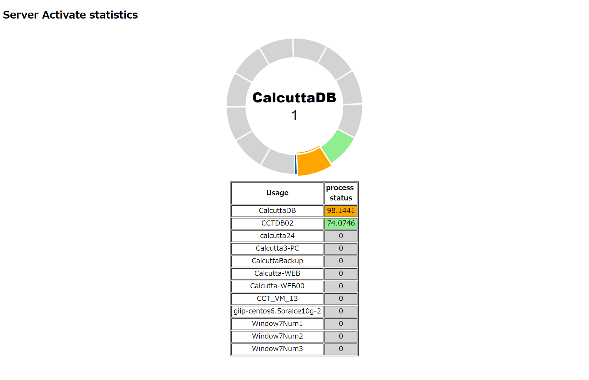

# Custom Dashboard

giip 는 HTML, ajax, jquery만으로 자신만의 대시보드를 만들 수 있습니다. 

## 대시보드 만들기

1. giipUI 샘플 다운로드
  * `git clone https://github.com/LowyShin/giip.git`
    * https://github.com/LowyShin/giip/tree/gh-pages/CustomUI
  * CustomUI 위치 : /giip/tree/gh-pages/CustomUI

2. CustomUI 디렉토리에서 morris_donut.html 파일을 HTML에디터로 열기

3. 필요 항목 입력후 저장
  ```
var lwsk = "<secret key>";
var lwfactor = "<factor of KVS>";
var lwattrib = "<attribute of KVS>";
```
  * secret key : 데이터를 보고자 하는 giip의 서비스에 연결되어 있는 secret key. giipagent에도 secret key가 들어있음.
  * lwfactor : KVS에 등록시킨 factor명
  * lwattrib : KVS에 등록시킨 데이터의 필드명

4. 브라우저에서 기동
  morris_donut.html 을 더블클릭하여 기동
  

* json을 활용한 테이블 뷰어 또는 그래프 뷰어는 모두 사용 가능하며, 
  그에 따른 API를 다양하게 호출하여 자신만의 대시보드를 만들 수 있습니다. 

