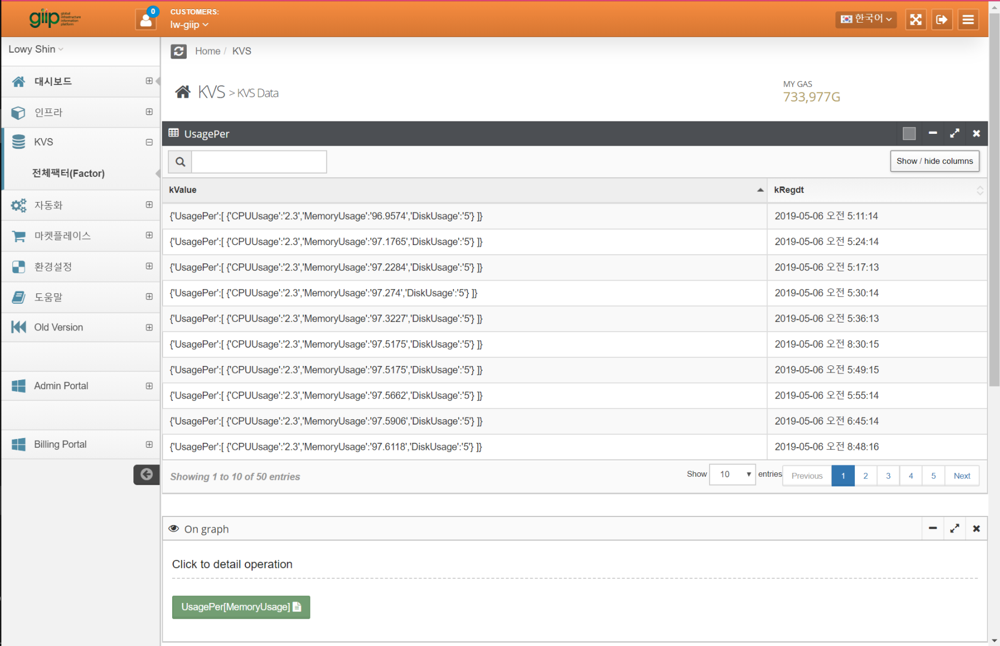
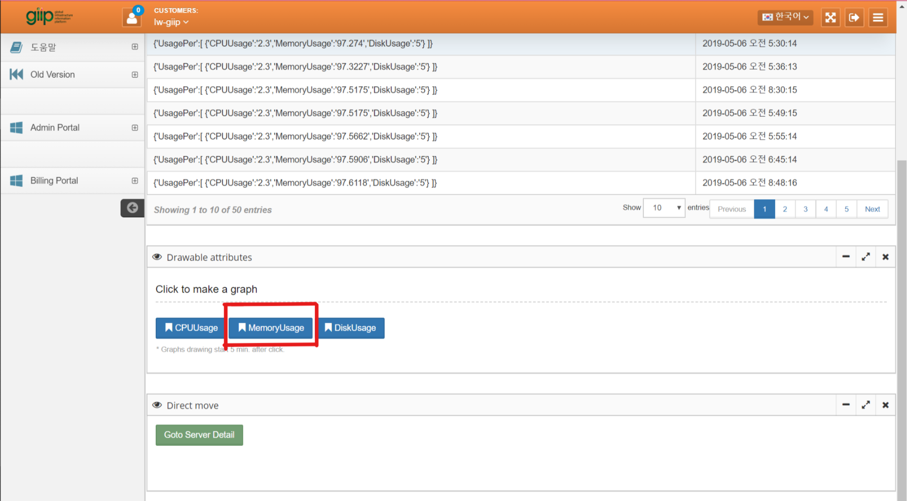
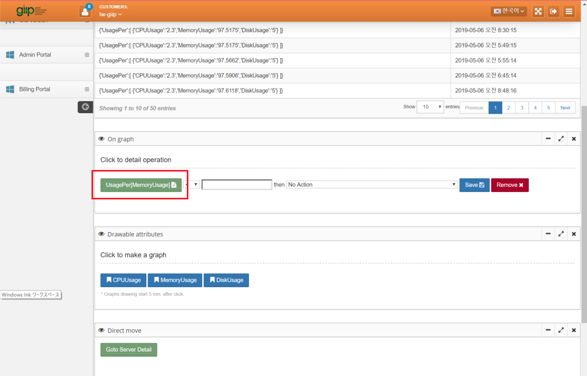
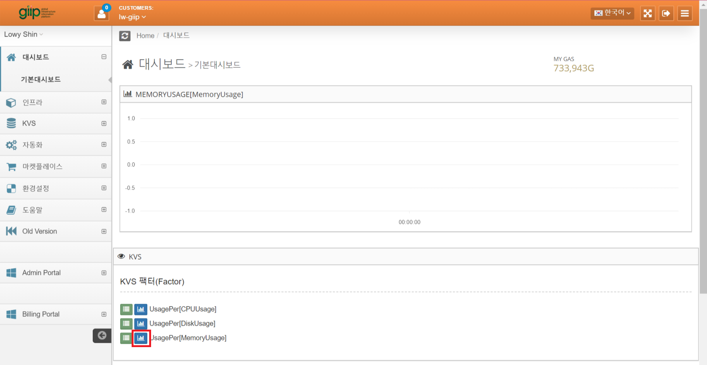
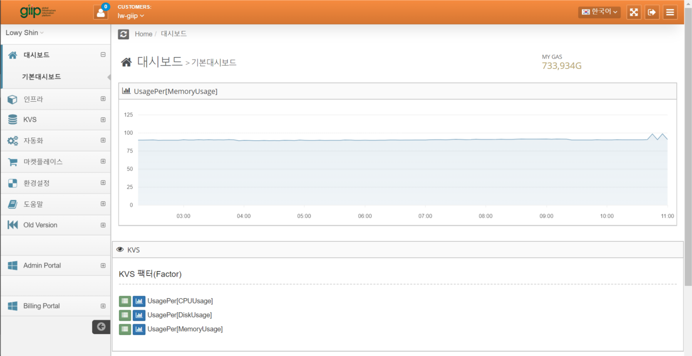

# KVS 데이터를 이용하여 Graph 만들기

giip는 어떠한 데이터라도 수치화를 시키면 쉽게 그래프를 만들 수 있습니다.
간단하게 시작할 수 있는 예제를 소개 합니다.

1. 우선 숫자 데이터를 KVS에 넣습니다.
  샘플 스크립트 : https://github.com/LowyShin/giip/tree/gh-pages/giipscripts

2. KVS > 전체Factor > KVS Data 페이지에 들어가면 선택한 Factor에 대한 로그가 보입니다. 
  

3. KVS Data페이지의 아래 쪽에 Drawable Attribute 항목에 파란색 버튼이 표시된다면, 이 버튼 부분이 그래프로 보일 수 있는 값들입니다. 이 중에서 하나를 클릭합니다.
  

4. 클릭이 되었다면 On Graph 라는 항목에 클릭한 Attribute가 보입니다. 이렇게 하면 준비 완료 입니다.
  
  * 버전에 따라 표시되는 내용이 다를 수 있습니다.

5. 대시보드에 가서 5분이상 기다립니다.
  그래프는 클릭한 시점부터 5분 마다 그려지기 때문에 클릭하자마자 나타나지는 않습니다.
  5분이 지나면 아래 쪽에 버튼과 Attribute가 표시 됩니다. 
  첫 번째 버튼은 상세 데이터 화면 이동 버튼이고, 두 번째 버튼이 그래프 표시 버튼입니다.
  

6. 대시보드에 KVS Factor부분에 항목이 떠 있다면 그래프 표시할 데이터가 있는 상태입니다.
  그래프 버튼을 클릭하면 그래프가 표시 됩니다.
  


### 그래프가 그려지지 않을 때(On-premise edition)

* graph에 필요한 데이터는 /OE/에 있는 giipQue.wsf파일을 주기적으로 실행시켜 생성합니다. 때문에 설정 후 5분후 부터 스케쥴러에 의해 giipQue.wsf파일이 실행되어 그래프를 그리는데 필요한 데이터가 생성되므로 그 이후부터 그려집니다. 
* 만약 5분이 지났는데도 그래프가 그려지지 않았다면 giip 서버에서 giipQue.wsf가 스케쥴러에 등록 되어있는지 확인해 주시기 바랍니다.
* 스케쥴러에서 OS의 버그로 실행중인채로 프리즈 되는 경우가 있습니다. 이 경우 giipQue.wsf스케쥴을 강제 종료하고 다시 실행해 주시기 바랍니다. 
* 테스트 또는 DB엔진의 스케쥴러에서 돌리기 위해서 아래 코드가 주석처리되어 있는 경우가 있습니다. 주석을 풀어주시면 그래프가 그려집니다.
  ```
' Input Triggerd Data to MQE for message and graph
lwSQL = "exec pMQETrgUpdateAuto"
RS.Open lwSQL, DBConn
```
